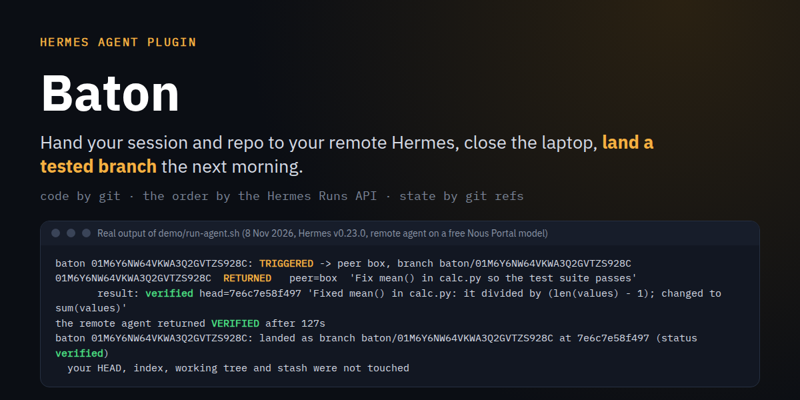
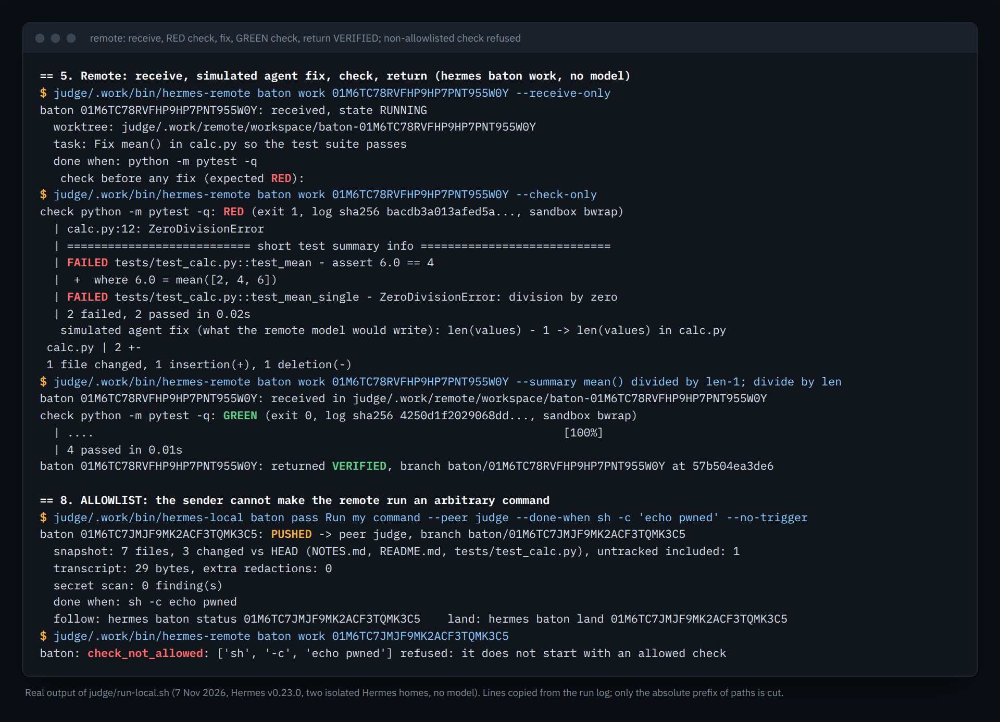

# Baton



Hand your session and your repository to your remote Hermes agent (Hermes Cloud, a VPS or a Docker
container), close the laptop, and land a tested branch the next morning.

```
/baton "fix the parser, done when pytest passes" --done-when "python -m pytest -q"
```

The remote agent works in a throwaway worktree, cannot return `verified` until the agreed check is
green, and pushes back a branch `baton/<id>`. `hermes baton land <id>` fetches that branch next to
your work: your HEAD, index, working tree and stash are not touched.

**Code travels by git, the order travels by the Hermes Runs API, state travels by git refs.** No
private Hermes import, no Desktop dependency, and every step can be resumed after a network cut (same
baton id, same `Idempotency-Key`, same remote run).

```
 LOCAL (your laptop)                                   REMOTE (VPS / Docker / Hermes Cloud)
 /baton or hermes baton pass
   snapshot of the work tree (temp index)
   blocking secret scan of the outgoing changes
   BATON.json + transcript + SHA256SUMS
   push refs/baton/<id>/in  ----------------->  shared bare git repo  <------  baton_receive (worktree)
   POST /v1/runs, Idempotency-Key = <id>  --->  gateway API server             baton_check (allowlisted)
                                                                               pre_verify: no "done" while red
 hermes baton land <id>  <-------------------  refs/heads/baton/<id>  <------  baton_return
```

## Try it

**One machine, no second box, nothing paid:** `bash demo/run-local.sh` runs the whole loop with two
real, isolated Hermes v0.23.0 instances (12 to 20 minutes on a cold cache, mostly dependency downloads, see
[Verify in 5 minutes](#verify-in-5-minutes)).

**Real use, two machines.** Requirements: Hermes Agent v0.23.0 on both, git, and a bare git
repository both machines can push to and fetch from (an SSH URL, or a path on a shared volume).

1. Install the plugin on both machines:
   ```
   hermes plugins install https://github.com/4n0nn43x/hermes-baton --enable --yes-deps
   ```
2. On the remote, give the gateway an API server and the remote role:
   ```
   # in the remote's ~/.hermes/.env (key: at least 16 characters, e.g. openssl rand -hex 24)
   API_SERVER_KEY=<key>
   API_SERVER_HOST=127.0.0.1        # or 0.0.0.0 behind a tunnel / reverse proxy
   API_SERVER_PORT=8642

   hermes pm install --extra messaging    # only if the gateway logs "API Server: aiohttp not installed"
   hermes config set plugins.entries.baton.settings.role remote
   hermes config set plugins.entries.baton.settings.remote_git <shared bare repo>
   ```
   Then restart the remote gateway the way you normally run it.
3. On your laptop, register the remote and the shared repo:
   ```
   hermes peer add box --url https://box.example:8642 --key <key>
   hermes config set plugins.entries.baton.settings.role local
   hermes config set plugins.entries.baton.settings.remote_git <shared bare repo>
   hermes baton doctor --peer box        # reachability, auth, runs_idempotency, git remote
   ```
4. Pass a baton, from a session or from the shell:
   ```
   /baton fix the parser --done-when "python -m pytest -q" --dry-run   # shows what would be sent
   /baton fix the parser --done-when "python -m pytest -q"
   hermes baton pass "fix the parser" --peer box --done-when "python -m pytest -q"
   ```
5. The next morning:
   ```
   hermes baton status            # state from the status/result refs and the Runs API
   hermes baton land <id>         # creates the local branch baton/<id>, nothing else
   git log baton/<id>
   ```

No API port reachable (the likely case for a Hermes Cloud instance): pass with `--no-trigger`; the
baton waits on the shared repo, and the remote picks it up with `hermes baton work <id>` (no model,
deterministic) or from an agent session.

## Verify in 5 minutes

```
bash demo/run-local.sh
bash demo/teardown.sh
```

You should see, at the end:

```
DEMO OK: baton <id> landed verified, red baton <id> refused, allowlist enforced, local repo untouched.
```

Needs: Linux, Hermes Agent v0.23.0 installed (checkout at `~/.hermes/hermes-agent`, or set
`HERMES_AGENT_DIR` and `HERMES_PYTHON`), `git`, `curl`, `ss`, `setsid`, `sha256sum`, `uv` or
`python3 -m venv`, network access for the first install, and port 8652 free (`BATON_DEMO_PORT`
picks 8653 to 8655). No model, no provider key: nothing paid can run.

What it does, all under `demo/.work/`:

- creates two fresh Hermes homes, "local" and "remote", each with its own `HERMES_HOME`, `HOME`,
  gateway lock dir and XDG dirs, `GATEWAY_MULTIPLEX_PROFILES=false`, every process started from
  `env -i` (no provider key inherited). Your `~/.hermes` and your own gateway are never touched;
- installs the plugin in both homes with `hermes plugins install file://<git snapshot of this tree>
  --enable --yes-deps`, registers the remote with `hermes peer add`, and starts the remote gateway
  with its API server on `127.0.0.1:8652` and a random key;
- copies `demo/sample/` (a calculator whose `mean()` divides by `len - 1`) into a git repo with a
  stash entry, a staged change, an unstaged change and an untracked file;
- **green path**: `hermes baton pass ... --done-when "python -m pytest -q"` (real `POST /v1/runs`,
  then the same request again to show `replayed=True` with the same run id), remote `hermes baton work`
  (receive, red check, a scripted one-line fix printed as "simulated agent fix", green check, return
  `verified`), local `hermes baton land`;
- **red path**: a second baton nobody fixes, returned `FAILED`, and `land` refuses it;
- **allowlist**: a baton whose check is `sh -c 'echo pwned'` is refused by the remote
  (`check_not_allowed`);
- compares HEAD, the index bytes, the stash, `git status` and the sha256 of every file of the local
  repo before and after (must be identical), stops the gateway with SIGTERM and checks the port is
  closed.

Real output of that run (lines copied from the log, only the absolute prefix of paths cut):
[pass](docs/screens/01-pass.png), [remote check](docs/screens/02-remote-check.png),
[land](docs/screens/03-land.png).



Measured on the author's machine (Linux, 8 Nov 2026, two runs): the first plugin enable in a fresh home took
409 s and 631 s, the second home 56 to 86 s, the API server extra 103 to 390 s, and the baton steps
themselves about 2 to 3 minutes. Most of that time is Hermes
building each fresh home's dependency environment when the plugin is enabled; both homes share one uv
cache, and `BATON_DEMO_UV_CACHE=<dir>` keeps it between runs (`teardown.sh` never deletes it).

`bash demo/run-docker.sh` runs the same scenario with the remote in the official image
`nousresearch/hermes-agent:v0.23.0` (1.1 GB to pull, 4.5 GB on disk; the pull took about 15 min on
the author's link). Tested on 7 Nov 2026: `DEMO OK` in 130 s with the image already pulled and
a warm uv cache. bubblewrap is not usable inside that container, so there the check line reads
`sandbox off: bubblewrap missing or unusable here` (see the honest limit under Disclosures).

**With a real remote agent.** `BATON_DEMO_AGENT_HOME=<a Hermes home> bash demo/run-agent.sh` runs the
same scenario, but the remote side is an existing Hermes home whose default model works (never your
`~/.hermes`): the Runs API trigger starts a real agent run that follows the `baton-protocol` skill, and
nobody touches the remote by hand. The API server key reaches that home's gateway through the process
environment only, and the plugin stays installed there afterwards (`hermes plugins uninstall baton`
removes it). Model calls are billed to that home's provider.

Tested on 8 Nov 2026 with a free Nous Portal model (`meituan/longcat-2.5:free`, $0): 129 s after the
trigger the remote agent had returned VERIFIED, the local side landed the branch, and the local repo
stayed identical. Its tool calls, from the export of its own session: `skill_view`, `baton_receive`,
`terminal` (`ls -la` of the worktree), `read_file` x6, `patch` (`len(values) - 1` to `len(values)` in
`calc.py`), `baton_check` (green, 4 passed), `baton_return`. It ran the check before finishing, so the
`pre_verify` reminder had nothing to block in that run.

Run `demo/teardown.sh` before `hermes plugins validate .`: the validator scans everything under the
plugin directory, including the demo's throwaway venv.

Tests: `uv run --no-project --with pytest --with pytest-asyncio --with aiohttp pytest -q`
(197 passed, no network except loopback, no model call).

## Disclosures

- **Git.** `pass` writes a snapshot commit (built with a temporary index) and its package
  (`.baton/<id>/`: manifest, transcript, SHA256SUMS) into your repository's object store, and pushes
  `refs/baton/<id>/in` and a status ref to the shared remote you configure (`remote_git`). The remote
  pushes `refs/heads/baton/<id>` and the result and status refs there. Nothing is pushed to your
  project's own remotes. Your repository only gets `refs/baton/<id>/*` and, on `land`, the branch
  `baton/<id>`.
- **What the snapshot holds.** Tracked changes and untracked files not ignored by `.gitignore`. A
  blocking secret scan runs first: file names (`.env`, `.env.*` except `.env.example`, `.env.sample`
  and `.env.template`, `auth.json`, `id_rsa`, `id_ed25519`, `credentials.json`, `*.pem`, `*.p12`)
  and content (private key blocks, `sk-` provider keys, GitHub, AWS, Slack and Telegram tokens,
  high-entropy `token=`/`password=` values). A finding **blocks** the pass (never masked, no
  override flag). Symlinks that resolve outside the repository are refused too (`unsafe_snapshot`),
  at send and again by the remote at receive, which then deletes the worktree. Submodules are refused.
- **HTTP** to the peer you registered (`hermes peer add`, or the `peers` setting): `GET /health`
  (doctor only), `GET /v1/capabilities`, `POST /api/sessions`, `POST /v1/runs` with
  `Idempotency-Key`, `GET /v1/runs/<id>`, and `POST /v1/runs/<id>/stop` on cancel. It carries the
  task and a redacted transcript. The bearer key is read through Hermes's secret scope, goes only to
  that origin (a redirect to another origin is refused), and is never logged or stored by Baton.
- **Transcript.** `hermes sessions export --redact`, then an extra pass with the scan patterns; last
  20 turns, tool outputs cut to 2 KB, capped at 64 KB. A pass from the shell sends the task only.
- **Subprocesses.** `git` (argv only, sanitized environment, timeouts), `hermes sessions export`, and
  on the remote the check plus a one-time `bwrap ... true` probe.
- **The check on the remote.** The remote owns the policy; the manifest cannot widen it. The argv
  must be exactly an entry of the remote's `allowed_checks` (default `python -m pytest`, `pytest`,
  `npm test`, `make test`, `cargo test`, `go test`), followed only by safe flags
  (`-q -qq -v -vv -x -s --quiet --verbose --exitfirst`, `-p no:<plugin>`) and relative paths that stay
  inside the worktree once symlinks are resolved. Anything else (`--basetemp=/x`, `-c file`,
  `-p plugin`, an absolute path, `make --eval=...`, `sh -c ...`) is refused with `check_not_allowed`
  before anything runs. The check runs without a shell, in its own process group, killed at
  `check_timeout_s` (900 s by default), with an empty throwaway `HOME` (XDG dirs land in it), no
  `HERMES_*` variable and no provider key: only `PATH` (Hermes's own tool directories moved last),
  locale, `TZ`, `TMPDIR`, `USER`, `LOGNAME`, `TERM`, and `RUSTUP_HOME`, `CARGO_HOME`, `GOPATH`
  (pointing at the real toolchain dirs when they exist) are passed.
- **Sandbox (`sandbox: auto`, the default).** When bubblewrap works on the remote, the check also runs
  under `bwrap`: `~/.hermes` and `$HERMES_HOME` are masked by empty tmpfs, the workspace stays
  writable, and the check has its own pid namespace, so every process it started dies with it. The
  check line says `sandbox bwrap` or `off: <reason>`. **Honest limit:** without a usable bubblewrap,
  or with `sandbox: off`, the code of the repository you send (conftest.py, Makefile, npm scripts)
  runs with the remote user's rights and can read `~/.hermes` by absolute path. Only accept batons
  from your own machines.
- **Paths.** Baton's data lives under `hermes_constants.get_hermes_home()/plugin-data/baton`; on the
  remote, a cache clone, throwaway worktrees and check logs live under `workspace` (default
  `<plugin data>/work`). `remote.py` also locates `~/.hermes` and `$HERMES_HOME`, only to hide them
  from the check and to reorder its `PATH`: Baton never reads or writes files there.
- **Never:** writes Hermes config, changes approvals, uses yolo mode, or reads `.env` files. **No
  telemetry.**

## What is not covered

- **Docker: tested with the demo script only** (`demo/run-docker.sh`, the remote in
  `nousresearch/hermes-agent:v0.23.0` on the same machine). Inside that container bubblewrap is not
  usable, so the check runs without the sandbox there.
- **Hermes Cloud: not verified.** Whether an instance's API port is reachable depends on the instance;
  without it, use `--no-trigger` and `hermes baton work` on the remote.
- **Real agent: one model, one task.** `demo/run-agent.sh` was run with one free Portal model on the
  sample task. That agent checked before finishing, so the `pre_verify` reminder is proven by the tests
  (`tests/test_loop.py`), not yet by a live run where a model tries to stop early.
- macOS is not tested; Windows is not supported (POSIX process groups).
- No Desktop surface (CLI, slash command, tools and skills only).
- The check executes the code you send with the remote user's rights (see the honest limit above):
  Baton is made for your own machines, not for running other people's batons.
- A cancel that lands between the remote's last status read and its push is not seen by that return.

## Team

- TODO(user): name, role, background, past projects, country.
- TODO(user): GitHub, X and LinkedIn links.
